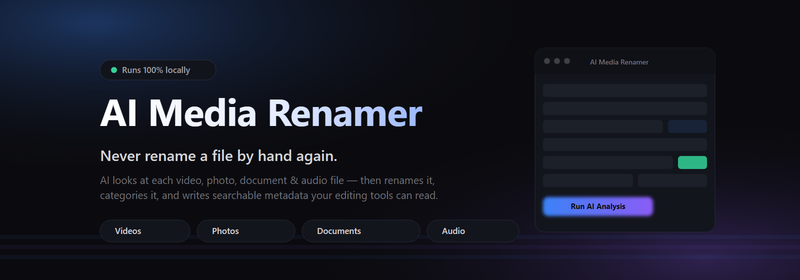
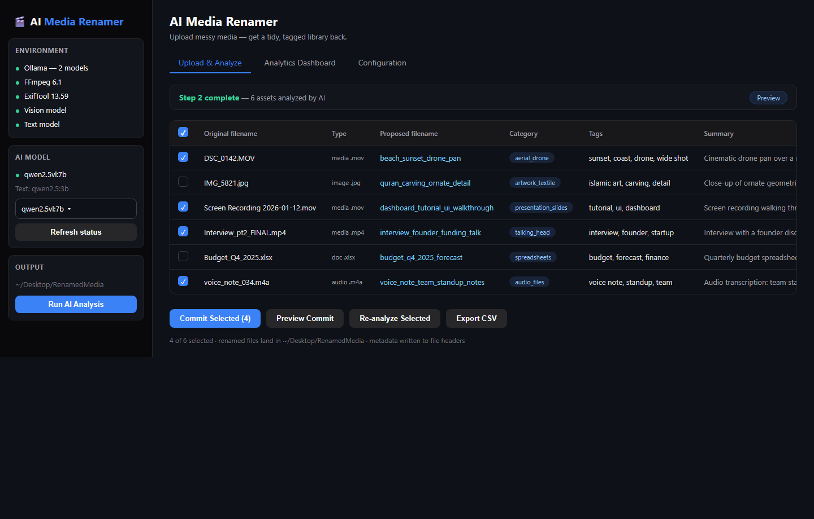
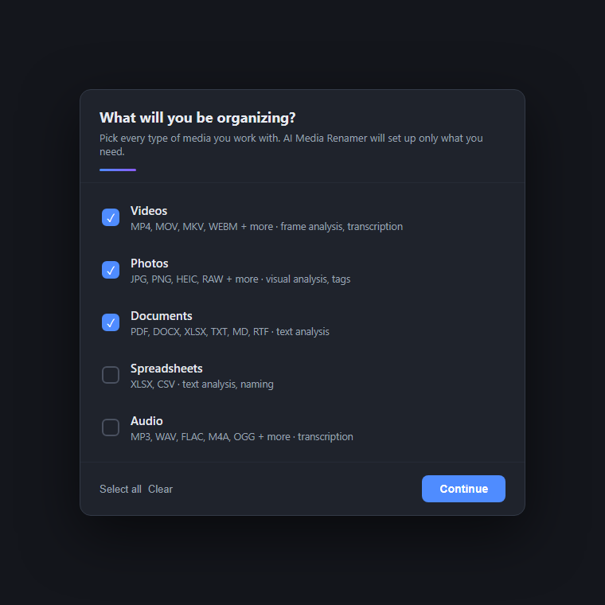

<div align="center">



# Your media library, organized by AI. In minutes, not weekends.

**Stop hunting through "final_v3_ACTUAL.mp4".**

AI Media Renamer looks at every video, photo, document, and audio file you throw at it — understands what's actually inside — then renames, categories, and tags everything so your library finally makes sense. It runs **100% on your own machine**. No cloud, no uploads, no subscriptions.

</div>

---

## Why you'll love it

**You lose hours every week to a messy media library.** Downloads folder full of `IMG_5821.jpg` and `Recording_004.m4a`. A freelance folder where every edit is `final_final_v2_really.mp4`. Your DaVinci or Premiere timeline is chaos because nothing has a name you can find.

This is the tool that fixes it.

- **Drop in your mess → get back order.** One click starts the AI. It samples a representative frame from every video, reads every document, transcribes every voice note, and figures out what each file is.
- **Names you'd actually search for.** `IMG_5821.jpg` becomes `quran_carving_ornate_detail.jpg`. `Recording_004.m4a` becomes `voice_note_team_standup_notes.m4a`.
- **Metadata written *into* the file — not a spreadsheet you'll ignore.** DaVinci Resolve and Premiere Pro read it natively; Explorer surfaces the EXIF keywords on images. Search "drone" and everything drone-related shows up.
- **Private by design.** Everything runs locally on the bundled llama.cpp runtime. Your family videos and client work never leave your computer.
- **Safe.** Nothing is touched until you hit Commit, and one click on **Rollback last batch** reverses it.

---

## What it looks like

<div align="center">



*AI reviews every file and proposes a filename, category, and searchable tags — all in one editable table.*



*A first-run wizard asks what you organize (videos, photos, docs, audio…) and sets up exactly what you need.*

</div>

---

## What it handles

| | What the AI does for it |
|---|---|
| 🎬 **Videos** | Watches a frame, reads the audio track, names the shot (`beach_sunset_drone_pan`) |
| 📷 **Photos** | Understands the subject, adds tags Explorer can search |
| 📄 **Documents** | Reads PDF, DOCX, XLSX, TXT, MD, RTF and names them by content |
| 🎧 **Audio** | Transcribes voice notes locally, names them from what was said |
| ♻️ **Duplicates** | Spots near-identical photos, videos, and audio before they double your clutter |

---

## Getting started

**AI Media Renamer v2** is a desktop-style app: a **React** frontend served by a **FastAPI** backend, with a **llama.cpp-only** local AI runtime (no cloud, no API keys). A first-run wizard downloads the llama.cpp server (~18 MB) and a vision/text GGUF model for you.

### Packaged / one-click

1. Download `AIMediaRenamer.exe` from the [Releases page](https://github.com/Abdulmusawwir/ai-media-renamer/releases/latest) — no installation, no accounts.
2. Double-click. The wizard sets up the local AI runtime on first launch, then opens the app in your browser on a loopback port (8000–8010).
3. Drop in your files → **Run AI Analysis** → review in the staging table → **Commit** (one-click Rollback reverses the batch).

### Run from source (dev)

```bash
# Backend (serves the API and, once built, the frontend)
uvicorn server.main:app --port 8000

# Frontend dev server (hot reload) in a second terminal
cd frontend && npm install && npm run dev
```

The React dev server proxies API calls to the backend; open the URL it prints (typically `http://localhost:5173`).

### Docker

```bash
# Build image (compiles the frontend) and run on http://localhost:8000
docker compose up --build
# Drop media into ./media to have it mounted into the container at /media
```

### Windows quick launcher

Run `start.bat` — it ensures Python (via winget if missing), installs the package with `pip install -e .`, then runs `launch.py` (free loopback port, browser opened automatically).

> Prefer the command line or want the full feature list, CLI flags, and system requirements? See [README_TECH.md](README_TECH.md).

### Security & LAN access

By default the server binds to loopback (`127.0.0.1`) and runs **unauthenticated** — safe because nothing is exposed beyond your own machine. Two opt-in knobs exist:

- **LAN sharing** — set `AMR_AUTH_ENABLED=1` to require a bearer token. The backend issues a short-lived JWT at `/api/auth/token`, and the frontend fetches it automatically and attaches it to both REST calls and the analysis WebSocket, so enabling auth stays transparent.
- **Custom secret** — set `AMR_JWT_SECRET` to override the dev fallback secret in any multi-user/LAN scenario.

---

## Who it's for

- **Content creators & editors** — whose drives are full of untitled exports.
- **Photographers** — drowning in `DSC_####` files that all look alike.
- **Freelancers & small studios** — needing client work organized and taggable.
- **Anyone with a chaotic downloads folder** — you know who you are.

---

## Roadmap — we're just getting started

- [x] **v2.1.0 — Auto-routing & release fix** — documents, spreadsheets, and audio are routed to their own naming profiles automatically, and the release build now compiles the React SPA before packaging.
- [x] **v2.0.0 — React + FastAPI rewrite** — llama.cpp-only local runtime, REST + WebSocket API, loopback-first LAN auth (JWT), and a packaged `AIMediaRenamer.exe`.
- [x] **Security hardening pass** — v1.6.3: checksum-verified downloads, frozen lockfile, secret redaction, keychain fail-closed, loopback-only server with LAN opt-in, input-validation hardening, log path redaction
- [x] **Stability & engine hardening** — v1.6.4: atomic config saves, import-safe startup, safer Clear All (sessions preserved), CLI argument validation
- [x] **Fully local & offline** — v1.7.0: cloud providers, API keys, and the keychain layer removed. Only local runtimes (llama.cpp).
- [x] **Auto-sorting into category folders** — `naming.sort_folders` (on by default) and `--sort-folders` / `--no-sort-folders`
- [ ] More AI models and language support
- [ ] Bulk import from cloud drives
- [ ] And whatever the community asks for next

---

## Support the project

If this saves you a weekend a month, consider [sponsoring the project on GitHub](https://github.com/sponsors/Abdulmusawwir) — it funds new features, testing, and the llama.cpp runtime downloads that keep everything 100% local.

[](https://github.com/sponsors/Abdulmusawwir)

---

<div align="center">

**Made with ❤️ from Tanzania by [Abdul Musawwir](https://github.com/Abdulmusawwir)**

Free forever · Open source · Runs on your machine, not ours

</div>
